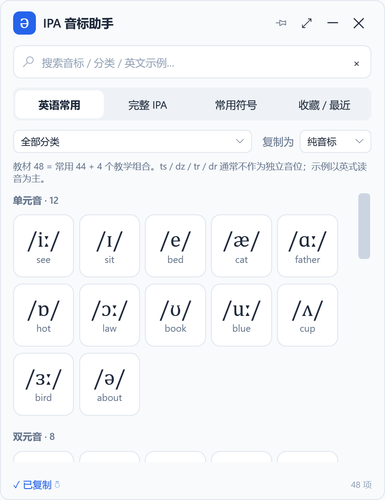
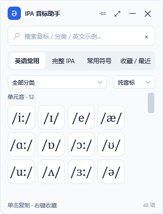

# IPA 音标助手 · IPA Clipboard

**放在桌面上的音标小面板：点一下，复制好，直接粘贴。**

Windows 10 / 11 x64 · 离线使用 · 单文件便携版 · 无需安装运行时

[**下载最新版**](https://github.com/PolarisFTL/ipa-clipboard/releases/latest) · [中文使用教程](docs/使用教程.md) · [反馈问题](https://github.com/PolarisFTL/ipa-clipboard/issues)

写英语材料、论文、课件时，不必反复查找或手动输入 `θ`、`ð`、`ʃ`、`ŋ`。打开音标助手，让它悬浮在编辑器旁，单击音标即可复制，再到 Word、PPT 或其他文本程序中按 **Ctrl+V**。

## 界面预览

下图来自程序实际 WPF 界面的渲染，展示完整模式和迷你模式。

<table>
<tr><th>完整面板</th><th>迷你面板</th></tr>
<tr>
<td valign="top"></td>
<td valign="top"></td>
</tr>
</table>

## 下载与使用

1. 打开 [Releases 下载页](https://github.com/PolarisFTL/ipa-clipboard/releases/latest)，下载附件中的 **`IPA-Clipboard.exe`**。
2. 双击 EXE 启动，单击需要的音标，例如 `/ʃ/`。
3. 看到“✓ 已复制”后，切回目标程序，按 **Ctrl+V**。

也可下载 **`IPA-Clipboard-v1.0.1-win-x64.zip`**，解压后运行其中的 **`IPA音标助手.exe`**。两种下载均为同一程序；单文件附件使用英文文件名，避免 GitHub 自动改写中文附件名。GitHub 自动生成的 `Source code (zip)` 是开发源码，普通使用请选择上面的 EXE 或便携包。

**不需要安装 Python、Java、Node.js 或 .NET Runtime，也不需要执行命令或配置环境变量。** EXE 自带运行时，约 61.89 MiB，首次启动会在当前用户的临时目录提取内置运行库。系统要求为兼容 .NET 10 的 Windows 10/11 x64。

## 能做什么

| 功能 | 使用方式 |
|---|---|
| 单击复制 | 直接写入 Windows Unicode 文本剪贴板，关闭软件后仍保留 |
| 三种复制格式 | 纯音标 `ʃ`、斜杠 `/ʃ/`、方括号 `[ʃ]` |
| 实时搜索 | 按音标、中文/英文名称、分类或示例词检索，如 `ship`、`鼻音`、`ɜː` |
| 桌面悬浮 | 默认置顶，点击图钉可取消；拖动标题栏文字或空白处移动 |
| 迷你模式 | 缩小成紧凑面板，保留音标、搜索、分类和滚动 |
| 收藏与最近 | 右键收藏；最近使用保留12项 |
| 偏好记忆 | 记住窗口位置、尺寸、置顶、模式、分类、复制格式与收藏 |
| 单实例 | 重复双击会唤起已有窗口 |
| 键盘操作 | Tab 导航，Enter / Space 复制，Shift+F10 打开收藏菜单 |

没有广告、账号注册、在线字体或网络 API。默认复制纯音标；特殊标记会原样复制，避免多加括号。

## 音标内容

**232 个分类条目、194 种不同复制内容**；同一个符号可以出现在不同标签中。

| 标签 | 条目数 | 内容 |
|---|---:|---|
| 英语常用 | 48 | 12单元音、8双元音、24辅音、4教学辅音组合 |
| 完整 IPA | 175 | 肺部气流辅音59、非肺部气流辅音11、元音28、附加符32、超音段9、声调与词重音24、其他12 |
| 常用符号 | 9 | 主/次重音、长/半长音、音节分界、停顿、鼻化和送气 |

英语区采用国内常见的“教材48”分类：**常用44 + `ts`、`dz`、`tr`、`dr` 四个教学组合**。这四个组合通常不作为四个独立英语音位。示例以传统英式宽式转写为主，不同口音可能有合并或其他读法。

“完整 IPA”按国际语音协会主图的主要分类整理，不含 extIPA、已废弃字母或所有可能的转写组合。教材 `/r/` 是英语宽式写法，常见语音实现为 `[ɹ]`；IPA 的 `r` 本身表示齿龈颤音。浊软腭爆破音使用 `ɡ`（U+0261），搜索 `g` 也能找到。详情见 [数据出处](SOURCES.md)。

## 两个小提示

- `◌̃`、`◌ʰ` 中的虚线圆圈仅作显示占位，**不会被复制**。组合附加符号应粘贴到基字之后，例如输入 `a` 后粘贴鼻化附加符，得到 `ã`。
- 目标程序决定粘贴后的字体。遇到缺字方块，可在目标程序中改用 **Cambria、Segoe UI 或 Segoe UI Symbol**。

设置保存在 `%APPDATA%\IPAClipboard\settings.json`。配置丢失或损坏时自动回到默认值；剪贴板被占用时会短暂重试，失败会显示“未复制”。软件不采集或保存其他应用的剪贴板历史。

## 开发与验证

使用 **C# / WPF / .NET 10**，发布为 Windows GUI 自包含单文件，关闭裁剪，内置图标和结构化音标数据。

- [构建说明](BUILD.md)：Windows 上一条脚本完成独立发布。
- [测试说明](docs/测试说明.md)：54项自测、桌面拖动、Word 粘贴与测试范围。
- [更新记录](CHANGELOG.md)：当前版本 **v1.0.1** 已修复标题栏空白区域拖动。
- [Windows 构建与发布工作流](.github/workflows/build.yml)：在 Actions 页面手动触发，构建并自测后生成发布附件。

代码采用 [MIT License](LICENSE)；音标数据整理采用 **CC BY-SA 4.0**，归属和第三方说明见 [SOURCES.md](SOURCES.md) 与 [THIRD-PARTY-NOTICES.md](THIRD-PARTY-NOTICES.md)。
